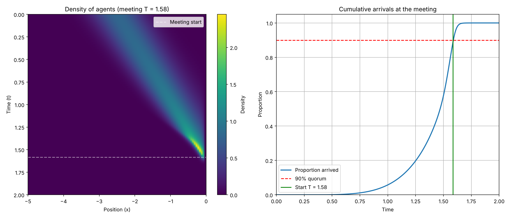
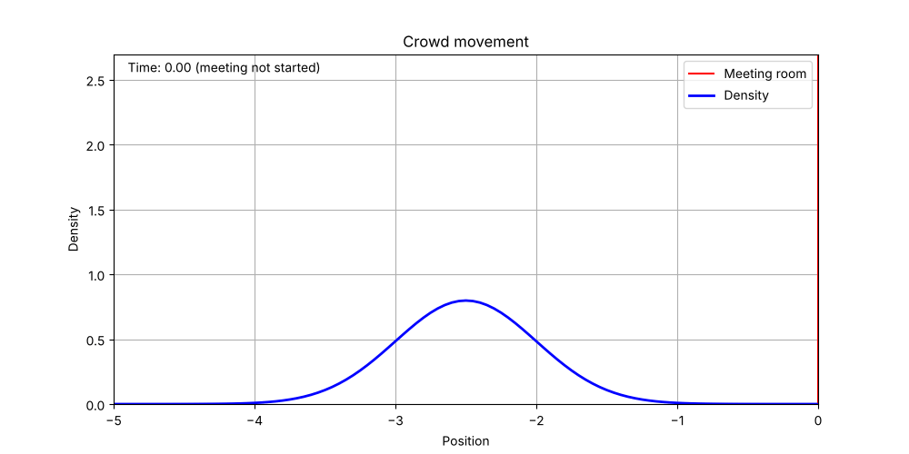

# Mean Field Games: when does the meeting start?

[](https://www.python.org/)
[](LICENSE)
[](https://github.com/dantor03/mean-field-game-meeting-problem/actions/workflows/ci.yml)

Finite-difference solver for the **meeting starting time** mean field game of
Guéant, Lasry and Lions (2011). A continuum of agents walks towards a meeting
room. Each agent chooses its speed to trade off effort against the cost of
arriving late or of waiting, and the meeting only starts once a quorum of
90% of the agents has arrived. The starting time $T$ is therefore an
equilibrium object: it depends on how agents move, and how they move depends on $T$.



With the default parameters the fixed point gives a starting time
$T^\ast \approx 1.58$, more than three times the scheduled time $t_s = 0.5$.

## Model

Agents start at $x \in [-5, 0)$ with a Gaussian initial density centred at
$-2.5$, and the room is at $x = 0$. Each agent controls its drift,

$$dX_t = a_t\,dt + \sigma\,dW_t, \qquad |a_t| \le a_{\max},$$

pays $\tfrac12 a_t^2$ per unit of time, and on arrival at time $\tau$ pays

$$c(\tau, T) = \alpha\,(\tau - t_s)^+ + \beta\,(\tau - T)^+ + \gamma\,(T - \tau)^+,$$

where $\alpha$ penalises lateness with respect to the scheduled time $t_s$,
$\beta$ lateness with respect to the actual start $T$, and $\gamma$ waiting.

For a given $T$, the value function $u$ and the density $m$ solve, with $\nu = \sigma^2/2$,

$$\partial_t u + \nu\,\partial_{xx} u - \tfrac12 (\partial_x u)^2 = 0, \qquad u(t, 0) = c(t, T),$$

$$\partial_t m - \nu\,\partial_{xx} m - \partial_x\big(m\,\partial_x u\big) = 0, \qquad m(t, 0) = 0,$$

with a reflecting wall at $x = -5$ and an absorbing boundary at the room.
The optimal control is $a^\ast = -\partial_x u$, clipped at $a_{\max}$.

**Equilibrium.** $T$ is the first time at which the arrived mass $1 - \int m(t,x)\,dx$
reaches the quorum $\theta = 0.9$. The solver iterates

1. solve the HJB equation backward in time for the current guess of $T$;
2. solve the Fokker–Planck equation forward with the optimal drift;
3. read off the quorum time $T_{\text{new}}$ and update $T \leftarrow \tfrac12 T + \tfrac12 T_{\text{new}}$,

until $|T_{\text{new}} - T| < 5\cdot 10^{-3}$.

## Numerics

- Grid: $N_x = 101$ points on $[-5, 0]$.
- HJB: central differences with gradient clipping ($a_{\max} = 5$).
- Fokker–Planck: conservative finite volumes with upwind advective fluxes and zero flux
  through the wall, so mass only leaves through the room and the arrivals are exactly
  one minus the remaining mass.
- Two time-steppers on the same spatial discretization:
  - `explicit` (default): forward/backward Euler with $N_t = 4001$ steps on $[0, 2]$;
  - `implicit`: IMEX, with implicit diffusion (sparse LU, factorized once) and explicit
    Hamiltonian and advection, stable with $N_t = 401$ steps.

  They give $T^\ast = 1.585$ and $1.601$; refining the implicit time step
  ($N_t = 1601$: $1.588$, $N_t = 4001$: $1.586$) converges to the explicit value.
- Parameters: $\sigma = 0.3$, $\alpha = \beta = 2$, $\gamma = 1$, $t_s = 0.5$, $\theta = 0.9$.

## Run

```bash
pip install -r requirements.txt
python meeting_time_mfg.py                    # explicit scheme
python meeting_time_mfg.py --scheme implicit  # IMEX scheme, about 10x faster
python meeting_time_mfg.py --show --no-animation
pytest                                        # tests (needs pytest), ~10 s
```

The script prints the fixed-point iterations and writes to `figures/`:

| File | Content |
| --- | --- |
| `meeting_time.png` | density heatmap and cumulative arrivals against the quorum |
| `meeting_time_3d.png` | density surface $m(t, x)$ |
| `meeting_crowd.gif` | animation of the crowd moving towards the room |



## Tests

`tests/` checks the arrival cost, the boundary conditions of the HJB solution,
that the density stays nonnegative and no mass crosses the wall, that both
schemes reach a fixed point, and that the explicit and implicit starting times
agree, with the implicit one converging to the explicit one as the time step
is refined.

## Reference

O. Guéant, J.-M. Lasry, P.-L. Lions, *Mean field games and applications*,
in *Paris-Princeton Lectures on Mathematical Finance 2010*, Lecture Notes in
Mathematics 2003, Springer, 2011, pp. 205–266.
